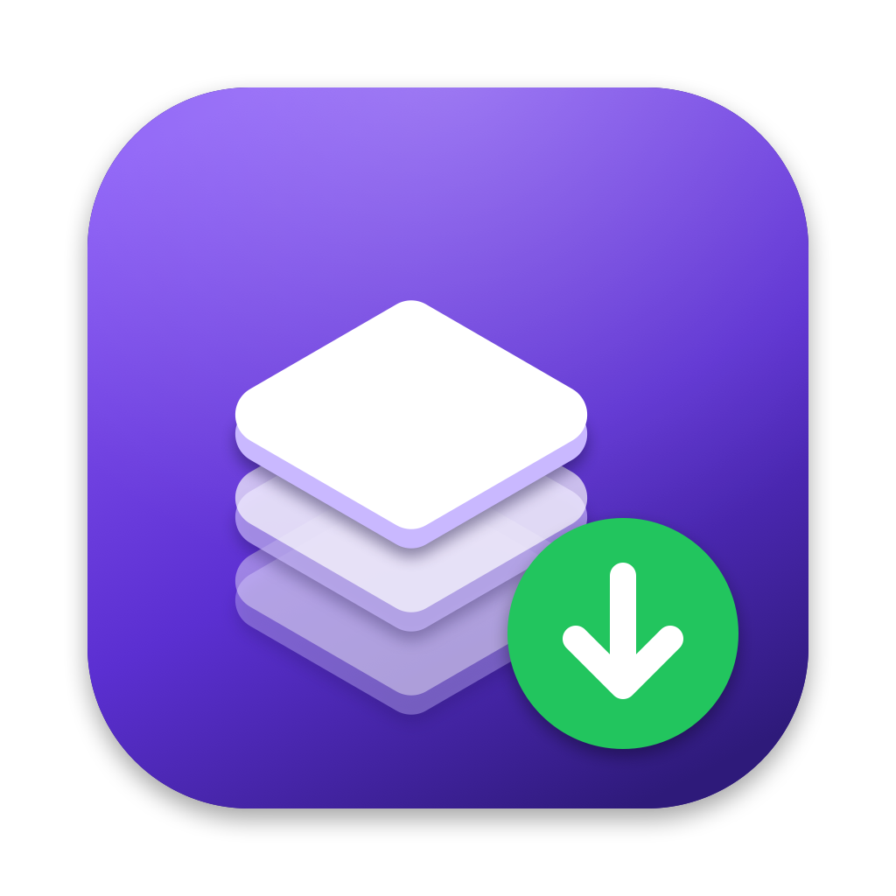

<p align="center"></p>

# DotNet Manager

A small native macOS app (SwiftUI) for managing .NET SDK and runtime installations: see what's installed, uninstall versions you no longer need, and install new ones from Microsoft's official release feed.

## Features

- **Installed**: lists every SDK, .NET runtime, ASP.NET Core runtime and other shared frameworks found in
  `/usr/local/share/dotnet`, `/usr/local/share/dotnet/x64`, `~/.dotnet` and `$DOTNET_ROOT`, with disk size. Filter by kind, multi-select, reveal in Finder.
- **Uninstall**: removes the version directory plus its leftovers (matching `packs`, `sdk-manifests` feature band, and `host/fxr` only when another one remains so `dotnet` keeps working), and forgets the matching `pkgutil` receipts.
- **Install**: browse .NET channels (LTS / STS / Preview / EOL) and releases from
  `builds.dotnet.microsoft.com/dotnet/release-metadata`, then install an SDK or runtime with one click. Downloads are restricted to Microsoft hosts, verified against the published SHA-512, and checked for a Microsoft package signature before `installer` runs.
- **Touch ID for admin actions**: privileged steps run through `sudo`, which shows a Touch ID prompt when Touch ID for sudo is enabled. If you cancel or Touch ID isn't available, it falls back to the standard macOS authorization dialog. The app never asks for or stores your password.

## Requirements

- macOS 14 or later (Apple Silicon or Intel)
- Swift 5.9+ (Xcode or Command Line Tools)

## Build

```bash
./build-app.sh
open "build/DotNet Manager.app"
```

The script builds a release binary with SwiftPM, wraps it in an app bundle with the icon, and ad-hoc signs it. To regenerate the icon, run `swift scripts/make-icon.swift`.

## Enabling Touch ID for sudo (optional)

macOS ships Touch ID support for `sudo` but leaves it off. To turn it on, run this once (it uses Apple's own template, which survives macOS updates):

```bash
sed -e 's/^#auth/auth/' /etc/pam.d/sudo_local.template | sudo tee /etc/pam.d/sudo_local
```

The app's sidebar shows whether it's on. This also enables Touch ID for `sudo` in Terminal.

## Project layout

```
Package.swift
Sources/DotNetManager/
  Views.swift             SwiftUI app, sidebar, installed table, release browser
  AppModel.swift          state and async actions
  Models.swift            installed components + release metadata models
  Services.swift          scanning, uninstall, download, verify, install
  TouchIDSudo.swift       sudo + Touch ID privileged execution
  PrivilegedRunner.swift  Authorization Services fallback
scripts/make-icon.swift   renders Resources/AppIcon.icns
build-app.sh              builds the .app bundle
```

## License

[MIT](LICENSE)

## Disclaimer

Not affiliated with or endorsed by Microsoft. ".NET" is a trademark of Microsoft Corporation. Uninstalling deletes files under your .NET install folders; use at your own risk.
